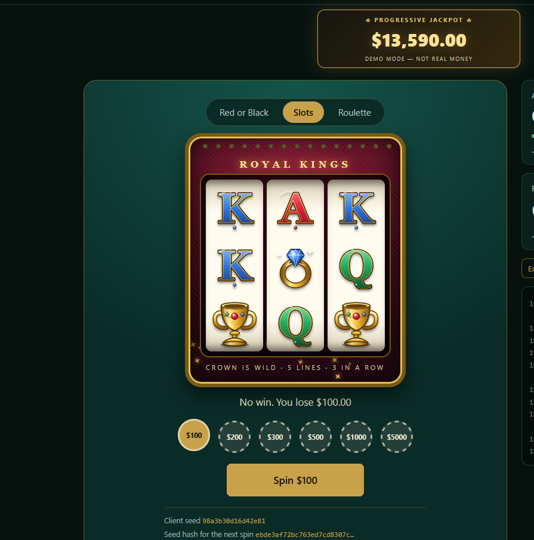
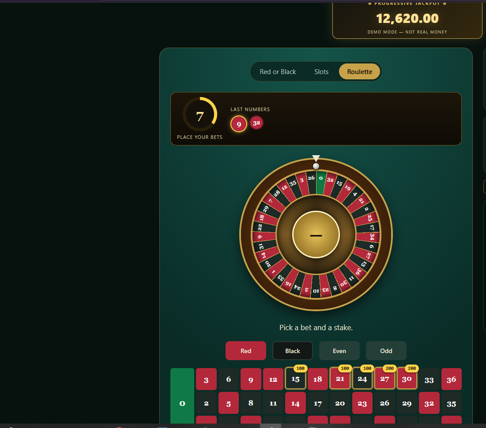
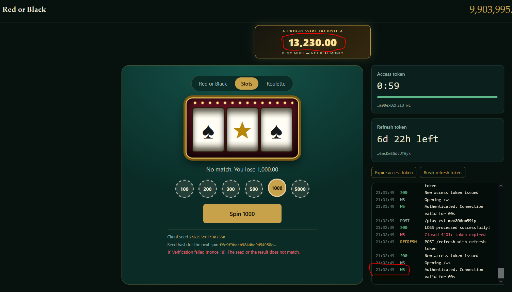
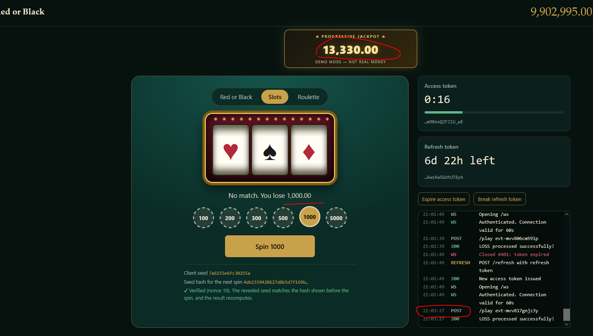
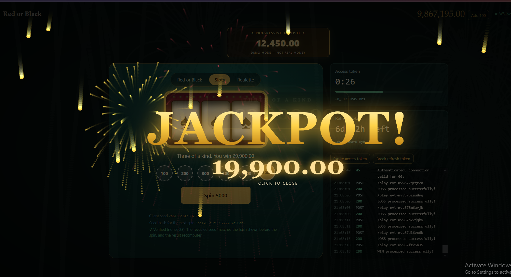
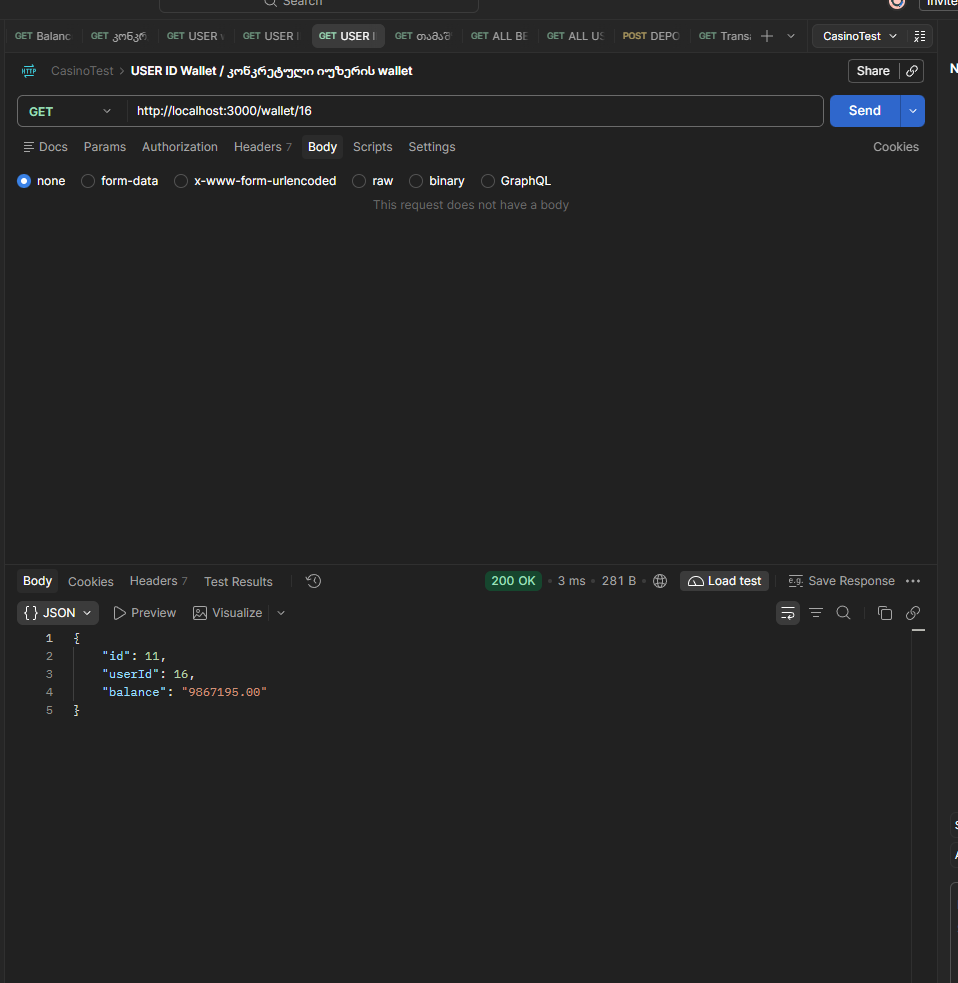
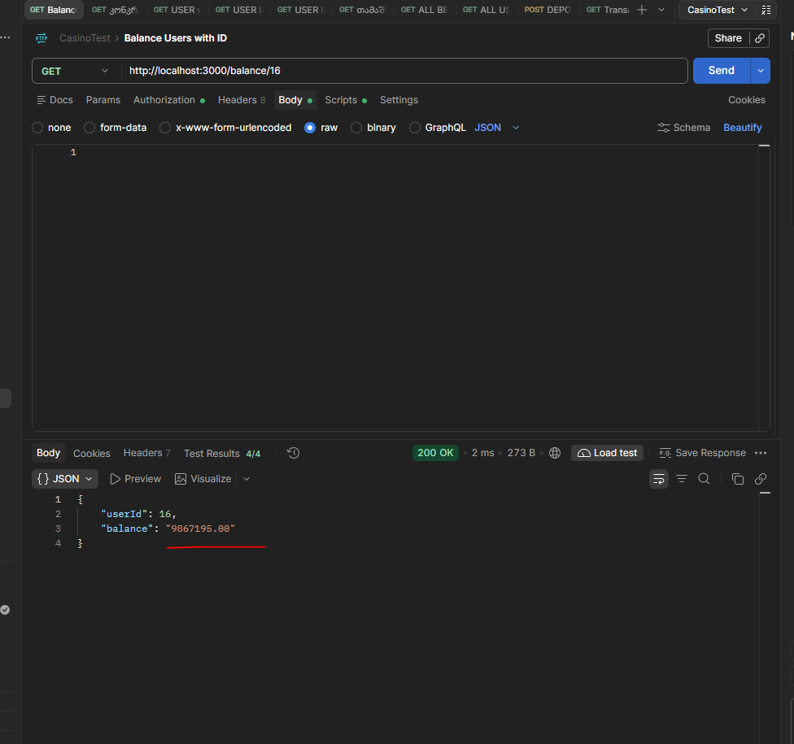
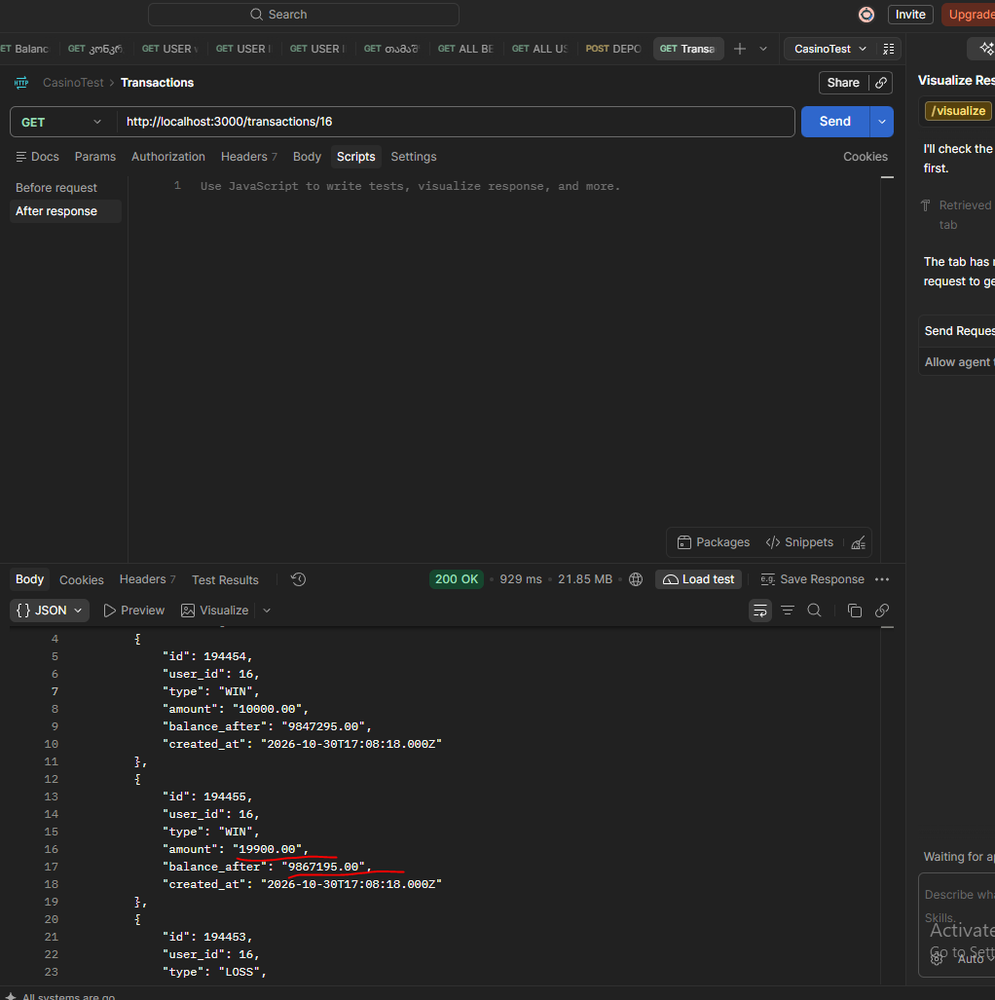
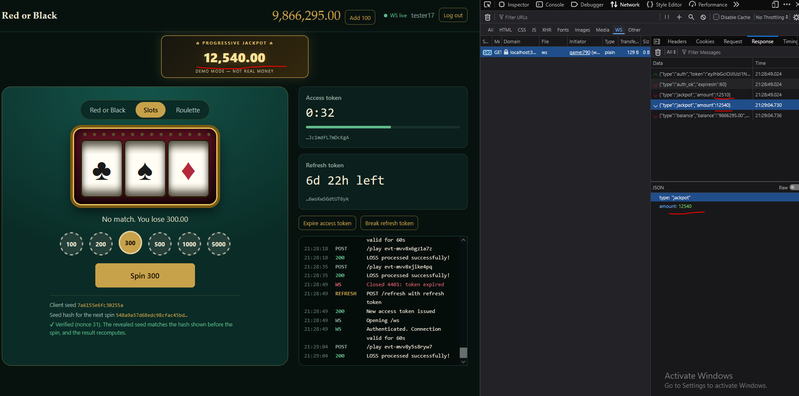

# 🎰 Jackpot System – Casino QA Project

## 1. Overview

This module documents the Progressive Jackpot functionality implemented in the Casino QA Testing Project.

The Jackpot System is integrated with two casino games:
- Slots
- Roulette

The system accumulates a progressive jackpot based on losing bets and distributes the jackpot prize to the winning player.

## 2. Jackpot Features

### 🎰 Slots Jackpot
- Progressive jackpot accumulation.
- Jackpot win scenario.
- Winner balance update.
- Jackpot reset after a successful payout.

### 🎡 Roulette Jackpot
- Jackpot accumulation through roulette bets.
- Jackpot winning scenario.
- Prize distribution to the player's wallet.
- Jackpot reset after winning.

### 💰 Progressive Jackpot Calculation

- 5% of losing bets is added to the progressive jackpot.
- Winning bets do not contribute to jackpot accumulation.
- The jackpot amount is updated according to the game results.

**Example:**

If a player loses a 1,000₾ bet:

1,000₾ × 5% = 50₾

The jackpot increases by 50₾.

### 🏆 Jackpot Payout

When a jackpot win is triggered:
- The winning player receives the jackpot prize.
- The player's wallet balance is updated.
- The jackpot amount is reset according to the configured initial value.

### 📡 WebSocket Integration

WebSocket is used to provide real-time jackpot updates.

Features:
- Live jackpot balance updates.
- Real-time communication between backend and frontend.
- Jackpot updates without refreshing the page.

## 3. QA Testing Scope

The following scenarios should be verified:

- Jackpot accumulation calculation.
- Slots jackpot functionality.
- Roulette jackpot functionality.
- Jackpot winning scenarios.
- Correct prize payout.
- Wallet balance verification.
- Jackpot reset after winning.
- WebSocket real-time updates.
- Duplicate payout prevention.
- Multiple simultaneous bets.

## 4. Technologies Used

- Node.js
- Express.js
- MySQL
- JavaScript
- WebSocket
- Kafka
- Postman
- SQL

## 5. Project Goal

The goal of this module is to demonstrate the implementation and QA testing of a Progressive Jackpot System in an online casino environment.

## 6. Screenshots & QA Evidence

The following screenshots demonstrate the Jackpot System functionality and testing results.

### Slots Jackpot

### Roulette Jackpot

### Progressive Jackpot Accumulation

### Jackpot Win Animation

### Jackpot Payout – Postman API Testing

### WebSocket Real-Time Updates

## 7. Testing Tools

- Postman – API testing and response validation
- MySQL – Database and wallet verification
- Chrome DevTools – WebSocket monitoring
- GitHub – Test documentation and evidence management
